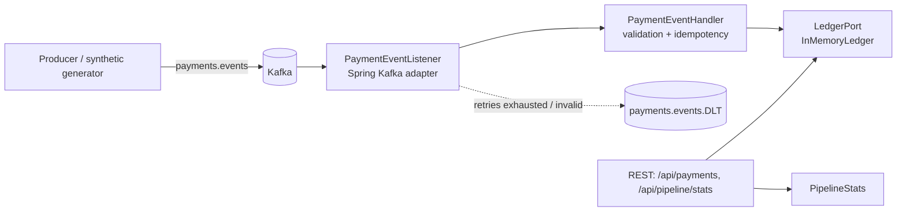

# payment-event-pipeline

A Spring Boot 3 / Java 21 Kafka consumer that applies payment lifecycle events to a ledger **exactly once in effect**, even when the broker redelivers messages, a downstream dependency fails, or a producer sends a malformed event.

> **Portfolio project.** This is an independently written demonstration that uses synthetic data only. It is not code from, or a copy of, any employer's or client's system.

## Business problem

Payment platforms receive the same event more than once (consumer rebalances, producer retries), see brief database outages, and occasionally receive events that can never be valid. If the consumer handles these naively, balances get double-counted, partitions stall behind a poison message, or events disappear silently. This project shows one way to make those failure cases explicit and testable.

## What it demonstrates

| Concern | How it is handled |
|---|---|
| Duplicate delivery | `IdempotencyStore` records each `eventId`; replays return `Duplicate` and leave the ledger unchanged |
| Transient failure | Handler releases the idempotency mark and throws `TransientFailureException`; Spring Kafka retries with exponential back-off |
| Poison messages | Bad JSON (`ErrorHandlingDeserializer`) and invalid events skip retries and go to `payments.events.DLT` |
| Business invariants | Ledger rejects captures above authorization, refunds above capture, currency changes and events on voided payments |
| Observability | `/api/pipeline/stats` counters, Actuator health/readiness/liveness, Prometheus metrics |
| Testability | Core logic is framework-free (`core/` package) and fully unit tested without a broker |

## Architecture



The `core` package has no Spring or Kafka imports. The `adapter` packages are thin translators, so swapping the in-memory ledger for PostgreSQL or the idempotency store for Redis changes one bean definition.

## Tech stack

Java 21 · Spring Boot 3.3 · Spring Kafka · Apache Kafka (KRaft) · Actuator + Micrometer/Prometheus · JUnit 5 · Docker · Kubernetes manifests · GitHub Actions

## Run locally

Prerequisites: JDK 21, Maven 3.9+, Docker.

```bash
# 1. Start Kafka and the service
docker compose up --build -d

# 2. Publish synthetic events (includes deliberate duplicates and invalid records)
docker compose exec -T kafka /opt/kafka/bin/kafka-console-producer.sh \
  --bootstrap-server localhost:9092 --topic payments.events < sample-data/events.jsonl

# 3. Inspect results
curl localhost:8080/api/pipeline/stats
curl localhost:8080/api/payments/pay-1000
```

Regenerate sample data with `java tools/GenerateEvents.java 500 > sample-data/events.jsonl`.

### Configuration

Copy `.env.example` to `.env`. All settings are environment variables with safe local defaults (see `src/main/resources/application.yml`). Retry behaviour is tunable through `pipeline.retry.*`.

## Tests

```bash
mvn verify
```

Unit tests cover duplicate suppression, validation, business-rule rejection, retry after a transient ledger failure, back-off calculation and ledger invariants.

## Deploying to Kubernetes

`deploy/k8s/deployment.yaml` defines a two-replica Deployment with resource limits, a non-root security context, readiness/liveness probes wired to Actuator, a ClusterIP Service and a ConfigMap for broker settings.

## Security notes

- No credentials are committed; configuration comes from environment variables or a ConfigMap. Use a Secret (or an external secrets manager) for SASL/TLS credentials in a real cluster.
- The JSON deserializer only trusts the `com.azamzia.payments.domain` package.
- The container runs as a non-root user.

## Limitations and next steps

- The ledger and idempotency store are in memory; a production version would use a transactional store (for example PostgreSQL with a unique constraint on `event_id`) so the mark and the ledger update commit together.
- Add Testcontainers-based integration tests against a real broker.
- Add an outbox for publishing downstream "payment settled" events.
- Add DLT replay tooling with operator approval.

## License

MIT
